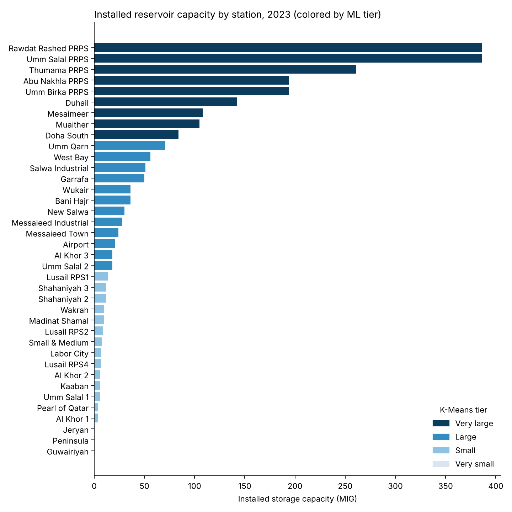

# 💧 Qatar Water Reservoir Capacity Analysis (Kahramaa, 2025)

Internship project: installed reservoir/pumping-station storage capacity in Qatar,
analysed with Python (pandas, scikit-learn), PostgreSQL and a dashboard.
The data is the **2023** Kahramaa release; the reporting year is unchanged.



## Key findings
- **2,415.5 MIG** (10.98 M m³) of installed storage across **38 operational stations**; Old Salwa is
  under upgrade (all reservoirs demolished) and counts as 0.
- **Highly concentrated** (Gini 0.67): the 5 Mega PRPS hold 58.8 %, the top 11 stations hold 80 %.
- The total sits almost exactly on the **2,400 MIG** target announced in 2015 for the Water Security
  Mega Reservoirs programme ([Gulf Times](https://www.gulf-times.com/story/430842/qr17bn-project-to-boost-water-storage-capacity/amp)).
- Against national production capacity of **537 MIGD** ([The Peninsula, Feb 2024](https://thepeninsulaqatar.com/article/25/02/2024/qatars-reserve-water-capacity-hit-20-in-2023)),
  storage covers roughly **4.5 days** of production. Derived here by dividing the two figures; it is a
  rough indicator, not an official Kahramaa metric.
- No station reports non-operating capacity, so "utilization" is 100 % everywhere. The earlier
  utilization analysis was dropped.

## What changed in this version
| Area | Fix |
|---|---|
| Data | Rebuilt from the raw XLSX by `src/build_dataset.py` with checks (installed = operating + non-operating, MIG↔m³ within 0.1 %). Old Salwa's null m³ resolved to 0 and flagged `Demolished (upgrade)`; added `status`, `station_type`, `commissioned_on`, `data_year`. `…csv.csv` renamed to `.csv`. |
| ML | `src/ml_models.py`: K-Means (k=4 by silhouette 0.61) and agglomerative tiering, Isolation Forest + MAD outliers (Jeryan, Guwairiyah, Peninsula, the smallest stations), Gini / Pareto concentration. |
| Charts | Five PNGs in `charts/` and an interactive `dashboard/dashboard.html`. The Power BI KPI cards were wrong; see `dashboard/POWERBI_FIXES.md`. |
| SQL | Split into `01_create_table`, `02_validate`, `03_analysis_queries`; added constraints and window-function queries. |
| README | Fixed paths that pointed to non-existent files. |

## Honest limits of the ML
Only 38 stations with a single numeric feature (capacity) are available, with no time series and no
demand data. The models are therefore **descriptive** (tiers, outliers, concentration), not
predictive. A forecast of capacity vs. demand needs data not in this repo (population, consumption,
production by year).
`src/fetch_external.py` can pull World Bank population / freshwater-withdrawal data and a Kaggle
dataset of your choice using the keys in `.env.example`. **It has not been run**: the environment
used to prepare this version could not reach those sites. The original source is the
[Qatar Open Data Portal](https://www.data.gov.qa/).

## Run it
```bash
pip install -r requirements.txt
python src/build_dataset.py   # raw XLSX -> data/water_stations_qatar_clean.csv
python src/ml_models.py       # -> data/station_clusters.csv, data/ml_summary.json
python src/make_charts.py     # -> charts/*.png, dashboard/dashboard.html
```
SQL: run `sql/01_create_table.sql`, load the CSV (`\copy` command inside), then `02_validate.sql`
and `03_analysis_queries.sql`. The query logic was checked against the data in SQLite; run it on
PostgreSQL to confirm.

## Structure
```
data/        raw XLSX, clean CSV, ML outputs
src/         build_dataset.py, ml_models.py, make_charts.py, fetch_external.py
sql/         PostgreSQL scripts
charts/      static charts
dashboard/   dashboard.html (interactive), .pbix (needs refresh, see POWERBI_FIXES.md)
```

## Acknowledgements & license
Data: [Qatar Open Data Portal](https://www.data.gov.qa/) / KAHRAMAA. MIT License (see `LICENSE`).
